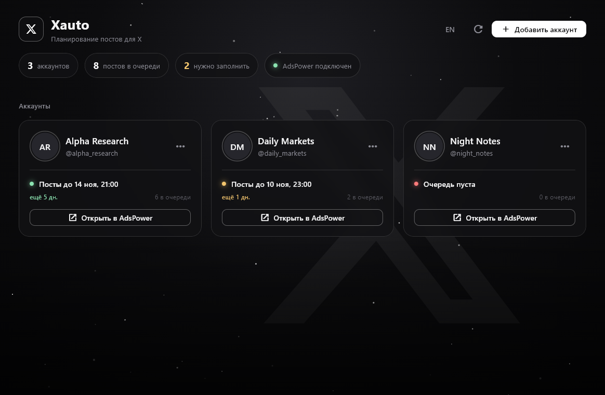

<div align="center">


# Xauto

**A local desktop dashboard for planning X (Twitter) posts across several accounts, built on top of AdsPower browser profiles.**




</div>

---

## Why

Running a few X accounts usually means a separate anti-detect browser profile
per account, a pile of drafts somewhere, and no quick way to see which account
is about to run out of planned posts. Xauto keeps all of that on one screen:

- every account as a card with its avatar, name and `@handle`;
- **one click opens the account** in its own AdsPower profile, straight on the
  X profile page, with that profile's fingerprint and proxy;
- a **traffic light per account** showing until when posts are planned
  (green: fine, yellow: refill soon, red: empty);
- a plain JSON **post queue** that can be filled by hand, by a script or by an
  AI assistant, and is picked up live while the app is open.

Everything runs locally. No accounts, cookies or proxies leave your machine.

## Features

| Status | Feature |
|:------:|---------|
| ✅ | Account list with avatars and names fetched automatically |
| ✅ | Open an account in its AdsPower profile on `x.com/<handle>` |
| ✅ | Queue overview: last planned post, days left, posts queued |
| ✅ | Live reload when `data/queue.json` changes |
| ✅ | Russian / English UI |
| ✅ | Posts screen per account, grouped by day, with media thumbnails |
| ✅ | Preview that looks like the real post on X (text, images, video with duration), approve / unapprove |
| ✅ | CLI to add posts safely: `python -m xauto add-post ...` |
| ✅ | Push approved posts into X's native scheduler through AdsPower, with a request guard that checks time, text and media before X accepts anything |
| ✅ | Telegram bot message with the link as soon as a scheduled post goes live |
| ✅ | One-hour stats (views, likes, replies, reposts) in Telegram and in the app |
| ✅ | Remote control from the same bot: open / restart / close a Claude Code terminal, take a screenshot |

## Requirements

- Windows 10 / 11
- Python **3.11+** on `PATH`
- [FFmpeg](https://ffmpeg.org/) on `PATH` (video thumbnails in the preview; optional)
- [AdsPower](https://www.adspower.com/) with the **Local API** enabled
  (*AdsPower → Automation → API*). The free plan is enough: Xauto only
  starts profiles, it does not list them.

## Quick start

```bash
git clone https://github.com/mrzion1/xauto.git
cd xauto
start.bat
```

`start.bat` creates a virtual environment on the first run, installs the
dependencies and launches the app. Later runs start instantly.

Then:

1. Click **Add account**.
2. Enter the X username and the **profile ID** from AdsPower (the `ID` column in the profile list).
3. The name and avatar are fetched automatically; the card appears on the home screen.
4. Use **Open in AdsPower** to jump into that account.

## Configuration

On first launch `config/settings.example.json` is copied to
`config/settings.json` (git-ignored):

```json
{
  "language": "ru",
  "adspower_api_url": "http://127.0.0.1:50325",
  "adspower_api_key": "",
  "refill_warning_days": 2
}
```

| Key | Meaning |
|-----|---------|
| `language` | `ru` or `en` (also switchable in the header). |
| `adspower_api_url` | Local API address shown in AdsPower's API settings. |
| `adspower_api_key` | Only if API key verification is turned on in AdsPower. |
| `refill_warning_days` | A card turns yellow when its queue ends within this many days. |
| `telegram_bot_token`, `telegram_chat_id` | Your bot; filled by `telegram-setup`. |
| `remote_bot_token`, `remote_chat_id` | The remote-control bot (separate from the post-links bot). |
| `claude_launcher` | `.bat` opened by the bot's `/claude` command (empty = off). |

## Post queue

Posts live in `data/queue.json`, attachments in `data/posts/<id>/`. Add them
with `python -m xauto add-post` (validates everything) or by editing the file.
The format is documented in
[docs/QUEUE_FORMAT.md](docs/QUEUE_FORMAT.md), with a ready-to-copy example in
[examples/queue.example.json](examples/queue.example.json).

## Scheduling on X

Approved posts go into X's own scheduler, so they are published even when
your PC is off.

```bash
python -m xauto schedule --account your_handle --dry-run   # full run, nothing created
python -m xauto schedule --account your_handle             # live
```

or press **Schedule on X** on the account's posts screen.

Everything runs in the background. If the account's AdsPower profile is
closed, Xauto starts it headless (no window, no focus stealing), types the
post, uploads the media, fills X's schedule dialog and closes the profile
again. If the profile is already open it is used as it is; when Playwright
cannot attach to it (seen with wallet extensions), you are asked to close the
window and schedule again. The browser's own clock converts the
time, so the profile's time zone (set by its proxy) never shifts a post.
Right before X receives the request, Xauto intercepts `CreateScheduledTweet`
and compares the UTC send time, the exact text and the attachment count with
the queue. On any mismatch the request is dropped and the post is marked
failed with a screenshot in its folder.

Requires Playwright (`pip install -r requirements.txt`); no separate browser
download is needed because it attaches to AdsPower's browser.

## Telegram: get the link when a post goes live

1. Create a bot with [@BotFather](https://t.me/BotFather) and copy its token.
2. Open your bot, press **Start**, then connect it (the token is stored in the
   git-ignored `config/settings.json`):
   ```bash
   python -m xauto telegram-setup --token <your bot token>
   ```
3. Arm the Windows task (no console window pops up):
   ```bash
   python -m xauto install-task          # remove with: python -m xauto uninstall-task
   ```

Nothing polls. The task "Xauto notify" only has one-shot triggers 1, 5 and 15
minutes after each scheduled post, and it is rebuilt automatically after
`schedule` and after every check. Each check reads the account's profile over
raw CDP in a background tab (the AdsPower profile is started headless and
closed again if it was not open), finds the post by its text and sends you the
link, usually within ten seconds. Checks after the link was sent do nothing.
If the post is still missing after the last one, you get the profile link to
check by hand. If the PC was off, Windows runs the missed check at startup and
the link is marked as late. Log: `data/notify.log`.

An hour after each post the same bot gets one short table: views, likes,
replies, reposts and bookmarks (numbers from the public FxTwitter API, no
browser). The snapshot is kept in the queue, so the app shows it on published
posts: views in the list, all counters under the post in the preview. If the
PC was off at that hour, the snapshot is taken at startup and labelled with
its real age. For posts published before this existed:

```bash
python -m xauto stats      # fill the snapshot once, no Telegram message
```

## Telegram: remote control

Remote control uses a **second** bot, so the post-links bot only ever carries
post links and their one-hour stats. The same bot is shared with Claude Code's
[Telegram channel](https://code.claude.com/docs/en/channels), and Telegram lets
only one program read a bot at a time, so it is handed back and forth:

| Claude terminal | Who reads the bot | What happens |
|-----------------|-------------------|--------------|
| closed | Xauto watcher | `/claude` opens it, `/screen` sends a screenshot, `/status` |
| open | Claude itself | you chat with Claude; `/screen` `/restart` `/stop` are done by Claude, restart / stop go through the watcher (`python -m xauto session restart\|stop`) |

The watcher starts at every Windows logon (Startup folder, no admin rights,
no console window), obeys your own chat only, drops commands older than
10 minutes, and never polls while a Claude channel is active (it checks the
plugin's PID file and backs off on 409 Conflict).

Setup:

1. Create a second bot with @BotFather; put its token into `remote_bot_token`
   and your chat id into `remote_chat_id` in `config/settings.json`.
2. Install the Telegram plugin and Bun, save the same token to
   `~/.claude/channels/telegram/.env`. Keep the plugin **disabled** in your
   user settings and enable it only for the remote session with
   `--settings`, or every normal Claude session would grab the bot.
3. Point `claude_launcher` at a `.bat` like:
   ```bat
   claude --channels plugin:telegram@claude-plugins-official ^
          --settings claude_tg_settings.json --append-system-prompt-file claude_tg_prompt.md
   ```
4. `python -m xauto install-remote --start-now` (remove with `uninstall-remote`).
   Open the terminal by hand with `python -m xauto session start` so the bot
   can still close or restart it. Log: `data/remote.log`.

## Privacy

This repository is public, your data is not:

- `data/` (accounts, AdsPower IDs, avatars, queue, media) and
  `config/settings.json` are git-ignored;
- a **pre-commit hook** scans every commit for IP addresses, proxies, API keys,
  tokens and e-mails, and blocks it if anything is found. Enable it once per clone:

  ```bash
  git config core.hooksPath .githooks
  ```

- CI runs the same scan over the whole repository on every push.

## Development

```bash
python -m venv .venv
.venv\Scripts\activate
pip install -r requirements-dev.txt
git config core.hooksPath .githooks

python -m pytest           # unit tests
python main.py             # run the app
python scripts/build_icon.py  # regenerate assets/icon.png and icon.ico
```

Project layout and design decisions: [docs/ARCHITECTURE.md](docs/ARCHITECTURE.md).

## License

[MIT](LICENSE)
